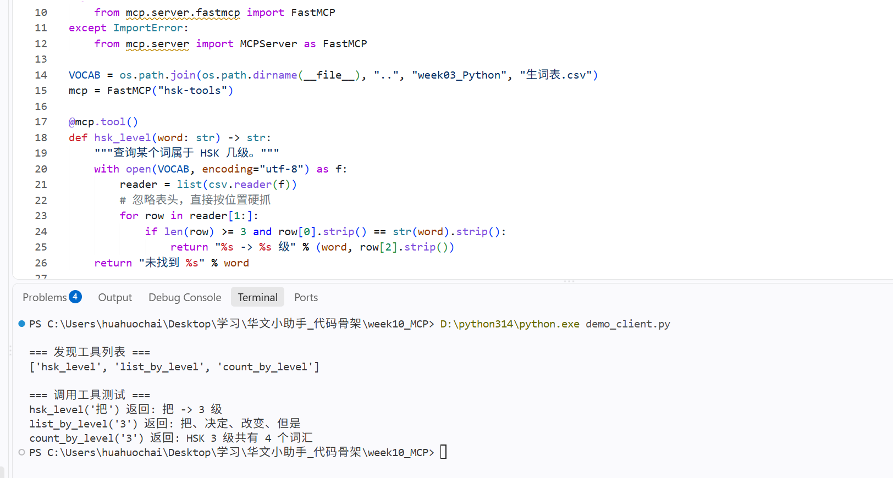

# MCP 与工具生态 实验记录 (实验3)

## 一、配置记录
- **客户端**：MCP 官方 Python 客户端 (stdio方式)
- **配置原文**：`{"mcpServers": {"hsk-tools": {"command": "python", "args": ["hsk_mcp_server.py"]}}}`

## 二、调用证据

## 三、三者辨析
1. **Function Calling**：是**模型侧**的机制，解决模型怎么“点名”要调哪个工具。
2. **MCP**：是**工具侧**的协议，解决工具怎么被统一发现和调用（像USB接口）。
3. **普通 API**：是**程序侧**的直接请求，没有模型决策参与。